# Sites OptimizerとJiraの統合

AEM Sites Optimizerから直接、商談の問題をJiraのチケットに変換できます。 各チケットには、影響を受けるページ、問題の詳細、提案された修正が含まれているため、チームはJiraで作業を計画および追跡できます。 選択した問題に対してコードパッチが提案されると、Sites Optimizerはそれをチケットに添付します。

<!-- VIDEO TODO: end-to-end overview (connect, configure, create). Upload through Experience League, then replace this comment with the video shortcode using the hosted video ID. -->

>[!NOTE]
>
>統合は、**Jira Cloud** サイトでのみ機能します。 Jira Data CenterとJira Serverはサポートされていません。

<!-- CONFIRM: availability wording. Trial users get the integration by default. Confirm what to tell paid customers (enablement through the account team / CSE?). The Create Jira ticket dialog shows a Beta badge, so confirm whether to say Beta or Early Access. -->

>[!AVAILABILITY]
>
>**設定**&#x200B;に&#x200B;**Jira Cloudへの接続**&#x200B;が表示されない場合は、アカウントチームまたはカスタマーサクセスエンジニアにお問い合わせください。また、**サポート対象の商談に対するチケットの作成**&#x200B;を行います。

## 仕組み {#how-it-works}

統合の設定には、次の3つの段階があります。

| ステージ | 誰が行うのか | ここで、 |
|---|---|---|
| [&#x200B; アカウントの準備](#prerequisites) | Jira サイト管理者とAdobe組織管理者 | Atlassian AdministrationとAdobe Admin Console |
| [Jiraを接続して既定値を設定](#configure-jira) | 接続を許可するSites Optimizer ユーザー | Sites Optimizerの&#x200B;**Settings** |
| [&#x200B; チケットを作成](#create-tickets) | 商談に取り組む人全員 | 商談ページ |

組織の最初の2つのステージは1回で完了します。 その後、アクセス権があれば、誰でもサポートされている機会からチケットを作成できます。

## アカウントの準備 {#prerequisites}

Sites Optimizerは、接続を許可するアカウントの代わりにJira チケットを作成します。 連携する前に、JiraとAdobeの両方でそのアカウントを準備します。 次の手順は、すべてのJira Cloud サイトに適用されます。

>[!TIP]
>
>個人アカウントの代わりに、接続に専用のサービスアカウント（例：`aso-jira@yourcompany.com`）を使用します。 個人アカウントは機能しますが、お勧めできません。チケットはその人の代理で作成され、接続は彼らのアクセスによって異なります。

### アカウントをJira サイトに招待する {#invite-to-jira}

1. [admin.atlassian.com](https://admin.atlassian.com)に移動し、組織を選択して、**ユーザーを招待**&#x200B;を選択します。

   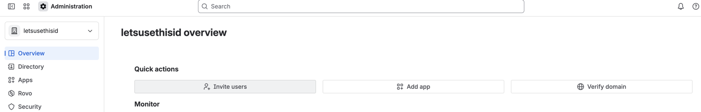{align="center"}

1. アカウントのメールアドレスを入力します。
1. **アプリ** リストで、**Jira**&#x200B;を見つけ、**役割**&#x200B;を&#x200B;**ユーザー**&#x200B;に設定します。 割り当てられた1つのスペースのみにアクセスできる&#x200B;**ゲスト**&#x200B;は使用しないでください。

   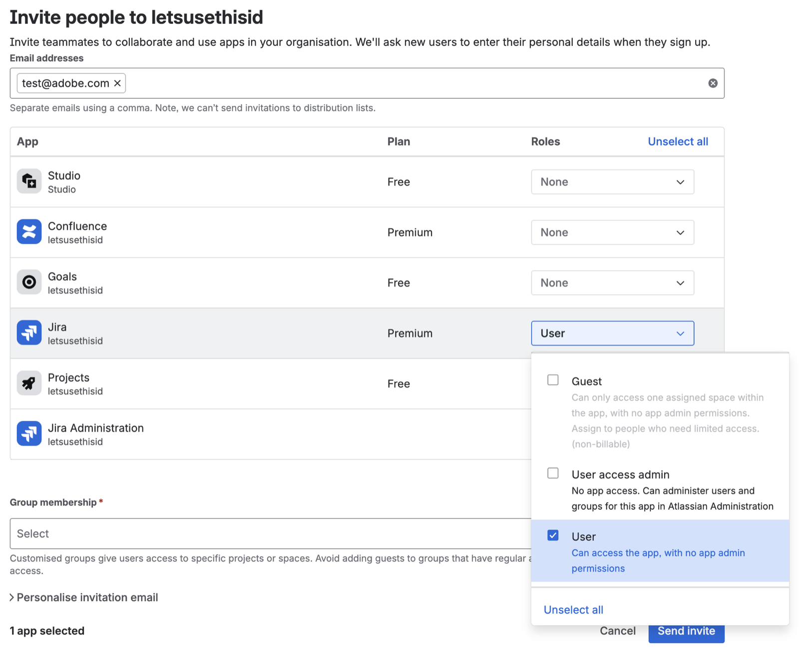{align="center"}に設定されたユーザーを招待ダイアログ

1. デフォルトのJira グループである&#x200B;**グループメンバーシップ**&#x200B;を`jira-users-<site>`に設定します。 これにより、製品アクセスと組み込みの&#x200B;**メンバー** プロジェクトの役割が付与されます。

   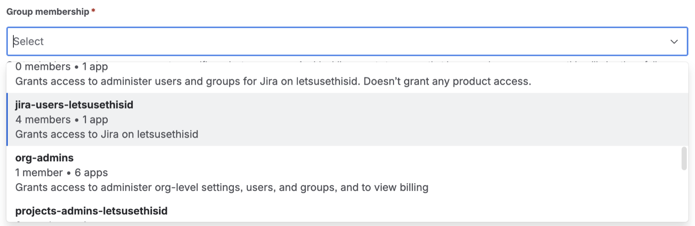{align="center"}

1. 役割が&#x200B;**ユーザー**&#x200B;で、グループが`jira-users-<site>`であることを確認し、**招待を送信**&#x200B;を選択します。

招待されたアカウントは招待を受け入れ、Atlassian アカウントでログインするか、作成します。

>[!IMPORTANT]
>
>Sites Optimizerでチケットを作成するJira プロジェクトごとに、アカウントでイシューを作成できるようにする必要があります。 プロジェクトでカスタム権限スキームを使用している場合は、Jira管理者にアカウントに&#x200B;**問題の作成**&#x200B;権限を付与するように依頼します。

### アカウントにSites Optimizerへのアクセス権を付与する {#grant-aso-access}

Jira接続を許可するアカウントは、組織のSites Optimizerにログインできる必要があります。 そのアクセス方法は、Sites Optimizer プランによって異なります。

>[!BEGINTABS]

>[!TAB 有料顧客]

アカウントをAdobe Admin ConsoleのAEM Sites Optimizer製品プロファイルに追加します。

1. [adminconsole.adobe.com](https://adminconsole.adobe.com)に移動し、**Products** > **Adobe Experience Manager Sites Optimizer**&#x200B;を選択します。
1. アカウントに必要な製品プロファイルを選択します。 Jira統合は、すべてのSites Optimizer製品プロファイルで使用できます。

   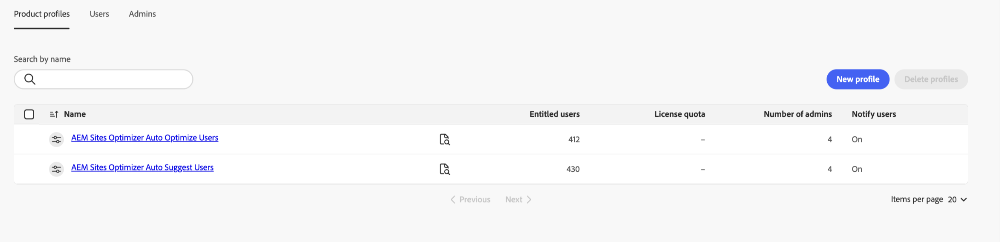{align="center"}

1. 「**ユーザー**」タブを選択し、「**ユーザーを追加**」を選択し、アカウントの電子メールアドレスを入力して、**保存**」を選択します。

製品のプロファイルと役割について詳しくは、[&#x200B; ユーザー権限の管理](/help/documentation/manage-permissions.md)を参照してください。

>[!TAB 体験版のお客様]

Sites Optimizer体験版には、Admin ConsoleにSites Optimizer製品プロファイルは含まれていません。 代わりに、アカウントはAdobe組織内のAdobe Experience Managerにアクセスする必要があります。

1. アカウントがAdobe組織内のユーザーであることを確認します。
1. アカウントに次の製品の少なくとも1つに製品プロファイルが割り当てられていることを確認します。

   * **Adobe Experience Manager as a Cloud Service**
   * **Adobe Experience Manager Managed Services**
   * **Adobe Experience Manager Edge Delivery Services**

   アカウントにこれらの製品プロファイルがない場合は、Adobe組織のシステム管理者に、[Adobe Admin Console](https://adminconsole.adobe.com)で製品プロファイルを割り当てるように依頼してください。

1. アカウントでSites Optimizerにログインし、組織を選択します。 [Sites Optimizer体験版](/help/documentation/trial.md)を参照してください。

>[!ENDTABS]

>[!IMPORTANT]
>
>Adobe組織&#x200B;**before**&#x200B;にアカウントを追加すると、Jira接続が承認されます。 それ以外の場合は、「この組織のメンバーではありません」で接続が失敗します。

## Jiraを接続してチケットのデフォルトを設定する {#configure-jira}

<!-- VIDEO TODO: connect and configure Jira (about 60 seconds). -->

### Jira に接続 {#connect-to-jira}

<!-- CONFIRM: only an administrator can connect Jira and set ticket creation defaults? Carried over from PR #162; not confirmed. -->

1. 準備したアカウントでSites Optimizerにログインします。
1. **設定**&#x200B;を選択し、**Jira Cloudに接続** セクションに移動します。 新しい接続にステータス **未接続**&#x200B;が表示されます。

   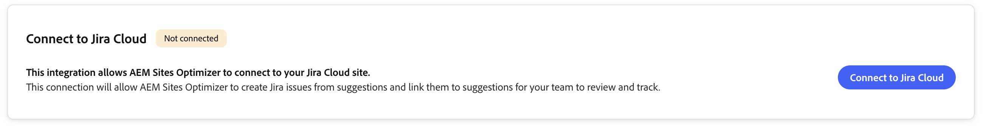{align="center"}

1. 「**Jira Cloudに接続**」を選択します。
1. Atlassian ページで、接続を認証し、プロンプトが表示されたらJira サイトを選択します。

   <!-- SCREENSHOT TODO: {align="center"} -->

Sites Optimizerに戻ると、ステータスは&#x200B;**Connected**&#x200B;に変わり、セクションには&#x200B;**Connected site**&#x200B;とJira サイト URLが表示されます。

>[!NOTE]
>
>接続は組織全体に適用されます。 すべてのサイトとユーザーが共有し、**設定**&#x200B;で行われた変更は全員に適用されます。 Jira サイトは一度に1つずつ接続できます。 別のJira サイトを使用するには、まず現在のサイトを切断します。

### チケット作成のデフォルト設定 {#ticket-defaults}

接続したら、Sites Optimizerが各チケットに適用するデフォルトを設定します。

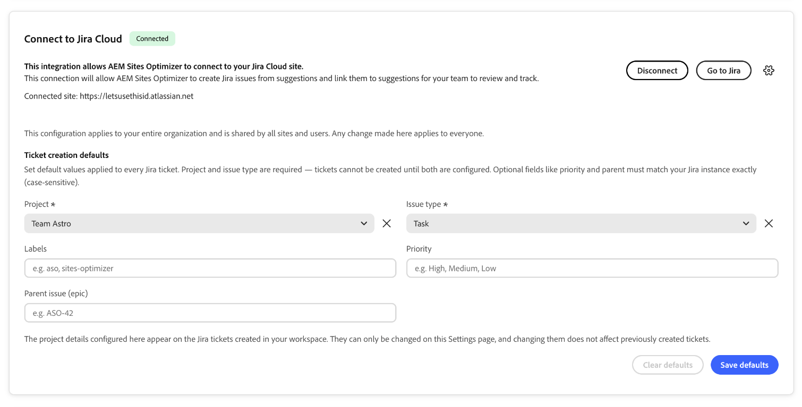{align="center"}を示す「Jira Cloudに接続」セクション

| フィールド | 必須 | 説明 |
|---|---|---|
| **プロジェクト** | はい | チケットが作成されるJira プロジェクト。 |
| **問題の種類** | はい | **タスク**&#x200B;などの新しいチケットのJira問題タイプ。 プロジェクトを選択した後に使用できます。 |
| **ラベル** | いいえ | `aso`や`sites-optimizer`など、すべてのチケットにラベルが追加されました。 |
| **優先度** | いいえ | デフォルトのチケット優先度（**High**、**Medium**、**Low**&#x200B;など）。 |
| **親問題（エピック）** | いいえ | チケットをリンクするエピックのキー（`ASO-42`など）。 |

「**デフォルトを保存**」を選択します。 「チケットのデフォルトが保存されました」というメッセージが表示され、変更が確認されます。

>[!IMPORTANT]
>
>チケットは、**プロジェクト**&#x200B;と&#x200B;**問題タイプ**&#x200B;の両方を設定するまで作成できません。 **優先度**&#x200B;と&#x200B;**親問題（エピック）**&#x200B;は、大文字を含め、Jira値と正確に一致する必要があります。

デフォルトに加えた変更は、新規チケットにのみ適用されます。 作成済みのチケットは変更されません。 チケットを作成する場合、保存されたデフォルトに影響を与えることなく、そのチケットのこれらの値のいずれかを変更できます。

### 接続を確認する {#verify-connection}

設定が機能することを確認します。

* **チケット作成のデフォルト**&#x200B;の&#x200B;**プロジェクト** リストに、Jira プロジェクトが表示されます。
* 商談からチケットを作成すると、Jira チケットキーとリンクが返されます。
* 問題に対してコードパッチが提案された場合、チケットはそれを添付ファイルとして含めます。

### 接続の管理 {#manage-connection}

**Jira Cloudへの接続** セクションのボタンを使用して、接続を管理します。

* **Jiraに移動**：接続しているJira サイトを開きます。
* **Jiraに再接続**：ステータスが&#x200B;**再認証が必要**&#x200B;の場合に表示されます。 同じJira サイトで接続を再度認証します。
* **切断**: **切断Jira?**&#x200B;を確認した後、統合を削除します。 もう一度つながるまで、オポチュニティからチケットを作成することはできません。
* **デフォルトをクリア**：保存されたすべてのデフォルトを削除します。 チケットの作成は、**プロジェクト**&#x200B;および&#x200B;**問題タイプ**&#x200B;を再度設定するまで利用できません。

### 接続エラーのトラブルシューティング {#connection-errors}

| メッセージ | 実行内容 |
|---|---|
| あなたはこの組織のメンバーではありません。 Jiraを接続する前に、管理者に追加を依頼してください。 | アカウントをAdobeの組織および製品プロファイルに追加します。 「[&#x200B; アカウントにSites Optimizerへのアクセス権を付与する](#grant-aso-access)」を参照してください。 |
| 別のJira サイトを選択しました。 まず現在の接続を切断してから、新しいサイトを接続します。 | 「**切断**」を選択し、目的のJira サイトを接続します。 |
| この Jira サイトへの接続は組織に対して既に存在します。 | サイトは既に接続されています。 **設定**&#x200B;を開いて、接続を確認します。 |
| Jira認証が拒否されました。 もう一度試して、プロンプトが表示されたらアクセス権を付与してください。 | 「**Jira Cloudに接続**」を再度選択し、アトラシアンページでのアクセスを許可します。 |
| 認証セッションの有効期限が切れました。 もう一度接続してみてください。 | **Jira Cloud**&#x200B;に接続を再度選択し、10分以内にAtlassianの認証を完了してください。 |

## Jira チケットを商談から作成 {#create-tickets}

チケットは、次の7つの商談から作成できます。

* [欠落している代替テキスト](/help/documentation/opportunities/missing-alt-text.md)
* [破損したバックリンク](/help/documentation/opportunities/broken-backlinks.md)
* [破損した内部リンク](/help/documentation/opportunities/broken-internal-links.md)
* [コア web バイタル](/help/documentation/opportunities/core-web-vitals.md)
* [&#x200B; アクセシビリティの問題](/help/documentation/opportunities/accessibility-issues.md) （ARIA ラベルの修正）
* カラーコントラスト
* [フォームのアクセシビリティの問題](/help/documentation/opportunities/forms-accessibility-issues.md)

<!-- CONFIRM: the docs repo has no page for the Color contrast opportunity (accessibility-issues.md does not mention it). Link it once a page exists. -->

この記事の例では、代替テキストの欠落、バックリンクの破損、Core Web Vitalsを使用しています。 手順は他の商談と同じです。

<!-- VIDEO TODO: create a ticket from an opportunity (about 60-90 seconds). -->

### チケットの作成 {#create-a-ticket}

サポートされている商談ごとに手順は同じです。

1. 商談を開き、1つ以上の問題を選択します。
1. 「**チケットを作成**」を選択します。

   Jiraが接続されていない場合、代わりにページに&#x200B;**Jira**&#x200B;の設定が表示されます。 これを選択して&#x200B;**設定**&#x200B;でJira セクションを開き、[Jiraの接続を完了してチケットのデフォルト設定](#configure-jira)を行います。

1. **Jira チケットを作成** ダイアログで、チケットの詳細を確認します。 ダイアログは、デフォルトと選択したイシューから事前入力されます。
1. 「**作成**」を選択します。

ダイアログには、次のフィールドが含まれます。

| フィールド | 説明 |
|---|---|
| **チケット名** | チケットの概要。 必須。 |
| **タグ** | Jira チケットにラベルが追加されました。 |
| **プロジェクト** | Jira プロジェクト。 必須。 |
| **優先度** | チケットの優先度。 |
| **問題の種類** | Jiraの問題タイプ。 必須。 まずプロジェクトを選択します。 |
| **エピック （親）** | `ASO-42`などの親エピックのキー。 |
| **問題名**&#x200B;および&#x200B;**問題説明** | 選択したイシューごとに1つのペア。 チケットを編集して、各イシューに関するチケットの内容を調整します。 |

Sites Optimizerがチケットを作成し、「Jira チケットが作成されました」と表示されます。 チケットのJira キーは、問題リストの&#x200B;**チケットリンク**&#x200B;列にリンクとして表示されます。 リンクを選択して、Jiraでチケットを開きます。 チケットがない場合は、ダッシュ（ – ）が表示されます。

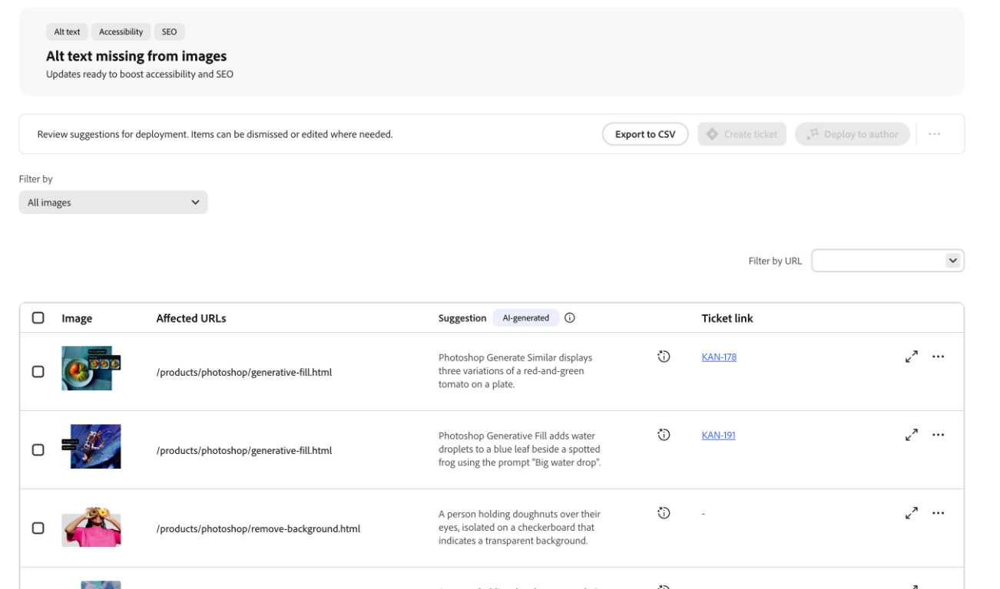{align="center"}

>[!NOTE]
>
>複数のイシューを選択すると、Sites Optimizerは、選択したすべてのイシューを一覧表示する&#x200B;**1つのグループ化されたチケット**&#x200B;を作成します。 各問題に対して個別のチケットを作成するわけではありません。 各イシューは1つのチケットにのみ属することができます。 問題が選択されていないか、選択した問題に既にチケットが含まれている場合、**チケットを作成**&#x200B;できません。 既にチケットリンクが表示されている問題をクリアしてから、**チケットを作成**&#x200B;を選択します。

<!-- CONFIRM: the Accessibility dialog uses a single Title and Description editor (with Preview) instead of per-issue Issue Name/Issue Description cards. Decide whether to call this out. Also confirm the accessibility code-fix attachment wording: it is attached only when the code-patch auto-fix is enabled. -->

**問題説明**&#x200B;および&#x200B;**説明** フィールドでは、`**bold**`、`*italic*`、`- bullets`、番号付きリストなどのMarkdownを使用できます。 書式を確認するには、**プレビュー**&#x200B;に切り替えます。

次の例では、Sites Optimizerの各顧客が利用できるオポチュニティを使用しているので、あらゆるプランで同じエクスペリエンスを確認できます。 最初の例では、1つの問題に対してチケットを作成し、2番目の例では一度に複数の問題に対してチケットを作成し、3番目の例ではコードパッチの添付ファイルを含むチケットを表示します。

### 例：1つの問題のチケットを作成する {#example-single-issue}

1つの修正に独自の所有者または期日が必要な場合は、1つの問題のチケットを使用します。 この例では、**代替テキストが見つかりません**。

1. 「**不足している代替テキスト**」を開き、1つの画像を選択します。

   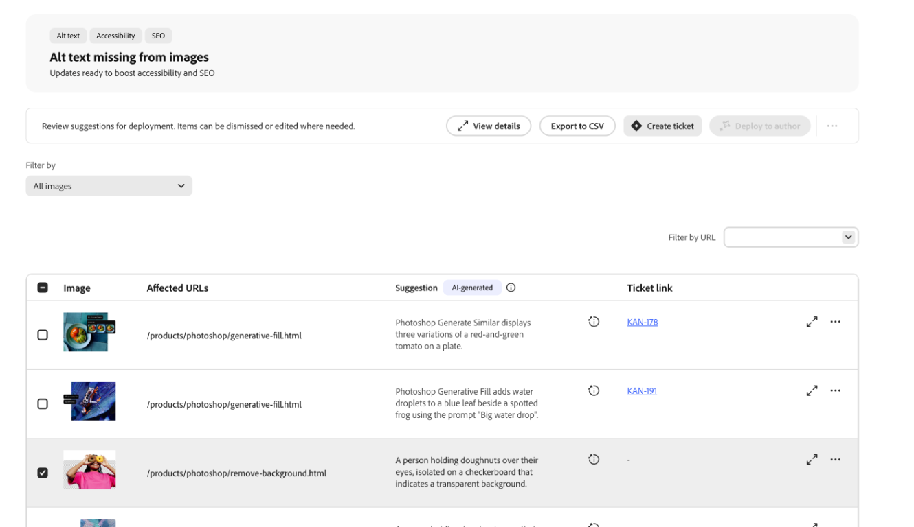{align="center"}

1. 「**チケットを作成**」を選択します。
1. **Jira チケットを作成** ダイアログで、`[ASO] Missing alt text – found on https://www.adobe.com/products/photoshop/generative-fill.html`などの&#x200B;**チケット名**&#x200B;を事前入力したままにするか、編集します。
1. **問題名**&#x200B;と&#x200B;**問題説明**&#x200B;を確認してください。 説明には、**ページ URL**、**画像URL**、**推奨の代替テキスト**&#x200B;が一覧表示されます。

   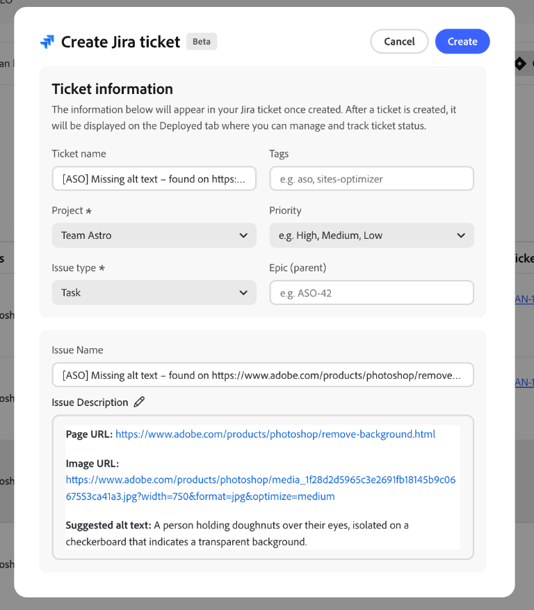{align="center"}

1. 「**作成**」を選択します。

Jira チケットには、影響を受けるページが一覧表示され、その後に問題が表示されます。

```markdown
**Affected pages:**
- https://www.adobe.com/products/photoshop/generative-fill.html

---

**[ASO] Missing alt text – found on https://www.adobe.com/products/photoshop/generative-fill.html**

**Page URL:** https://www.adobe.com/products/photoshop/generative-fill.html

**Image URL:** https://www.adobe.com/cc-shared/fragments/products/photoshop/generative-fill/personalization/media_1986ceaab1420f3df0c4ff92b962e01bd402c0d53.jpg?width=750&format=jpg&optimize=medium

**Suggested alt text:** Photoshop Generate Similar displays three variations of a red-and-green tomato on a plate.
```

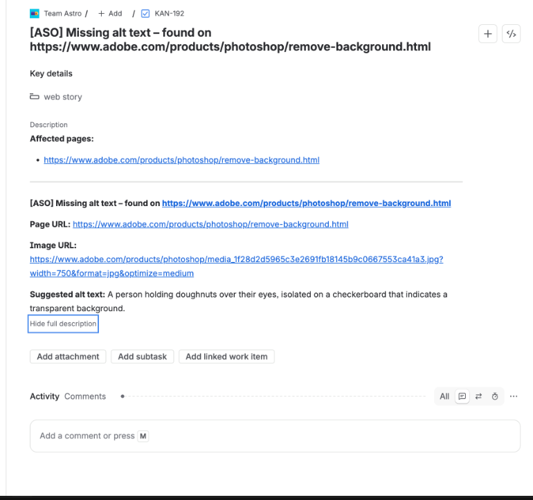{align="center"}

### 例：複数の問題に1つのチケットを作成する {#example-multiple-issues}

ひとつのチームが複数の問題を同時に解決する場合は、グループ化されたチケットを使用します。 この例では、**壊れたバックリンク**&#x200B;を使用しています。

1. **壊れたバックリンク**&#x200B;を開き、複数のバックリンクを選択します。
1. 「**チケットを作成**」を選択します。
1. **Jira チケットを作成** ダイアログで、**チケット名**&#x200B;を確認します。 いくつかの問題を選択すると、影響を受けるページの数（`[ASO] Broken backlink found – 2 pages`など）が表示されます。 ダイアログには、選択したバックリンクごとに&#x200B;**問題名**&#x200B;と&#x200B;**問題説明**&#x200B;のペアが1つ表示されます。

   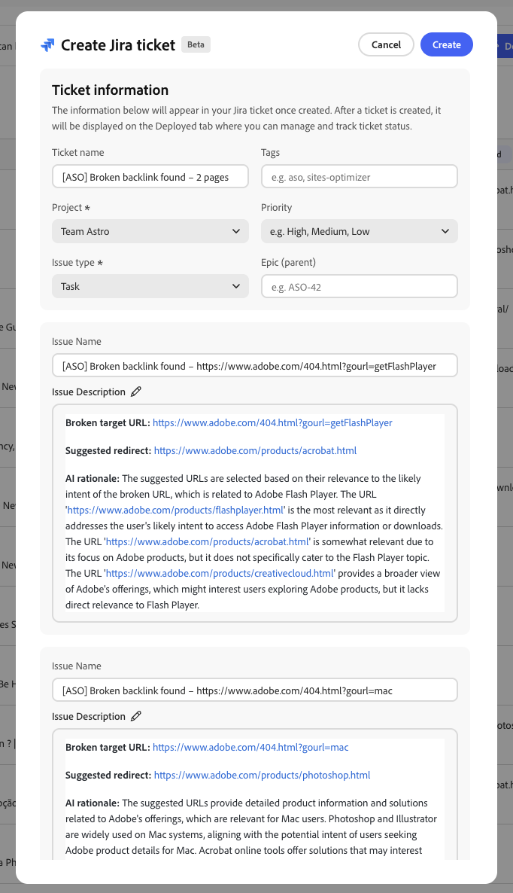{align="center"}

1. 各バックリンクについて、**壊れたターゲット URL**&#x200B;と&#x200B;**推奨リダイレクト**&#x200B;を確認してください。 使用可能な場合、説明には&#x200B;**AIの根拠**&#x200B;も含まれます。 商談で提案されたリダイレクトを編集した場合、チケットは編集したURLを使用します。
1. 「**作成**」を選択します。

Sites Optimizerはチケットを1枚作成します。 参照ページが一覧表示され、各バックリンクのセクションが続きます。 横線はセクションを分離します。

```markdown
**Referring pages:**

- https://archive.nytimes.com/www.nytimes.com/library/cyber/qa/101797qa.html
- https://www.theguardian.com/education/gcses2003/0,13395,976930,00.html

---

**[ASO] Broken backlink found – https://www.adobe.com/support/flash/how/subjects/jpdemo/**

**Broken target URL:** https://www.adobe.com/support/flash/how/subjects/jpdemo/

**Suggested redirect:** https://www.adobe.com/support/flash/

---

**[ASO] Broken backlink found – https://www.adobe.com/shockwave/download/download.cgi?P1_Prod_Version=ShockwaveFlash&P5_Language=English**

**Broken target URL:** https://www.adobe.com/shockwave/download/download.cgi?P1_Prod_Version=ShockwaveFlash&P5_Language=English

**Suggested redirect:** https://www.adobe.com/shockwave/download/
```

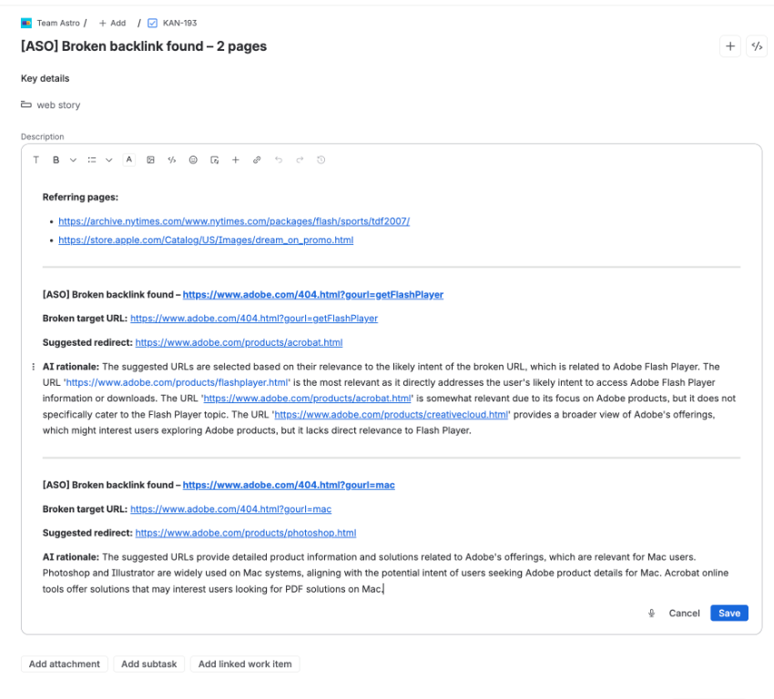{align="center"}

両方のバックリンクは、グループ化された1つのチケットに属しているため、**チケットリンク**&#x200B;列に同じJira キーが表示されるようになりました。

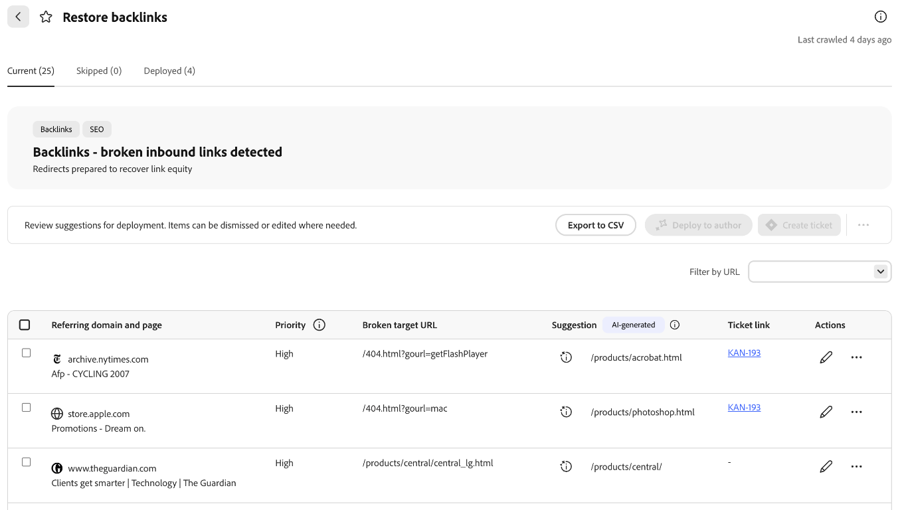{align="center"}

### 例：コードパッチ添付ファイルを含むチケット {#example-core-web-vitals}

Sites Optimizerが選択した問題に対するコードパッチを提案すると、そのパッチがJira チケットに添付されます。 複数のパッチが適用される場合は、それらを1つのファイルに結合して、開発者が変更をレビューして適用できるようにします。 Core Web Vitalsはよくある例です。

1. **Core Web Vitals**&#x200B;を開き、修正するページを選択します。
1. 「**チケットを作成**」を選択します。
1. ダイアログで、`[ASO] Core Web Vitals issue – 2 affected pages`などの&#x200B;**チケット名**&#x200B;と、各ページの詳細を確認します。

   * **ページ**
   * **デスクトップに関する問題**: デスクトップ上の失敗した指標とその値。
   * **モバイルの問題**: モバイルの失敗した指標とその値。
   * **Recommendations**: ページの修正候補。

   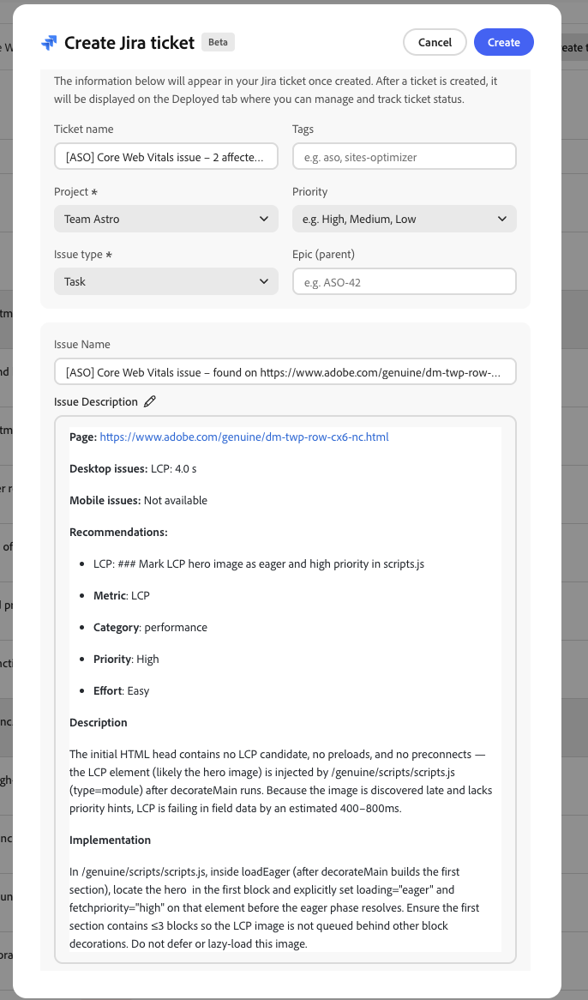{align="center"}

1. 「**作成**」を選択します。

選択したページに対してコードパッチが提案された場合、1つの`.diff` ファイルとしてチケットに添付されます。 チケットには最大3 MBの添付ファイルが1つしかありません。 パッチが提案されない場合でも、Sites Optimizerは詳細と推奨事項を含んだチケットを作成しますが、添付ファイルは作成されません。

>[!NOTE]
>
>選択範囲のコードパッチの合計が3 MBを超える場合、チケットを作成できません。 ページを少なくして、チケットを再度作成します。

添付ファイル セクション 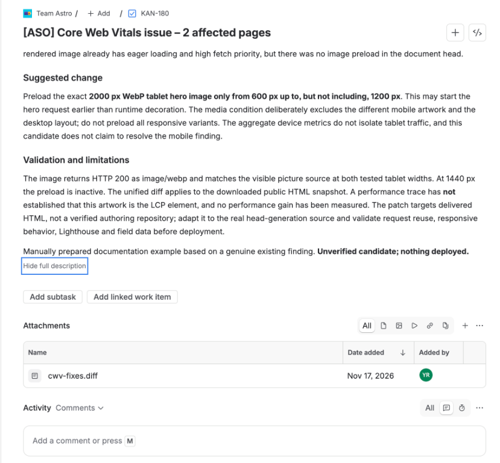{align="center"}の結合されたコード パッチ ファイルを使用して、Core Web Vitalsから作成されたJira チケット

Jira チケットから`.diff` ファイルをダウンロードし、例えば`git apply`を使用してコードリポジトリに適用します。 ファイルには、選択した各ページのパッチが含まれています。

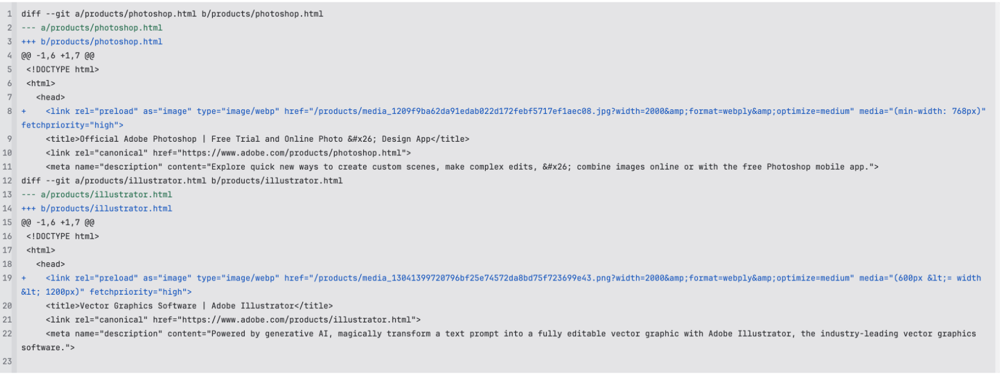{align="center"}

結合する前に変更内容を確認します。 詳しくは、[&#x200B; コードパッチの準備](/help/documentation/opportunities/preparing-code-patches.md)を参照してください。

## 各チケットに含まれるもの {#ticket-contents}

| 機会 | チケット詳細 |
|---|---|
| 欠落している代替テキスト | 影響を受けるページと、各画像のページ URL、画像URL、および提案された代替テキスト。 |
| 破損したバックリンク | 参照ページと、各バックリンクについて、壊れたターゲット URLと提案されたリダイレクト。 可能であれば、AIの根拠。 |
| 破損した内部リンク | 参照ページと、各リンクに対して、壊れたターゲット URLと提案されたリダイレクト。 可能であれば、AIの根拠。 |
| コア web バイタル | 影響を受けるページと、各ページのデスクトップの問題、モバイルの問題、および推奨事項。 チケットに推奨コードパッチが添付されています。 |
| アクセシビリティの問題（ARIA ラベルの修正）、カラーコントラスト、Formsのアクセシビリティの問題 | 影響を受けるURL、問題の説明、欠陥のあるHTMLの場所、および推奨される修正。 コードの修正が可能な場合は、チケットに添付されます。 |

## チケット作成のトラブルシューティング {#ticket-errors}

Sites Optimizerで「Jira チケットの作成に失敗しました」と表示された場合は、次の点を確認してください。

* **プロジェクトとイシューの種類**：選択したプロジェクトとイシューの種類は引き続きJiraに存在し、接続されたアカウントはそのプロジェクトでイシューを作成できます。
* **必須フィールド**: Jira プロジェクトでは、カスタムの必須フィールドなど、Sites Optimizerで入力しない追加フィールドは必要ありません。 追加の必須フィールドなしでプロジェクトまたはイシュータイプを選択するか、Jira管理者に対してこれらのフィールドをオプションにするように依頼します。
* **優先度と親**: **優先度**&#x200B;と&#x200B;**エピック（親）**&#x200B;は、大文字を含め、Jira サイトに存在する値と完全に一致します。
* **添付ファイルのサイズ**: コードパッチを適用したチケットの場合、結合されたパッチは3 MB以下になります。 問題を少なくして、もう一度試してください。
* **接続ステータス**: **設定**&#x200B;では、**Jira Cloudへの接続** ステータスは&#x200B;**接続**&#x200B;です。 **再認証が必要**&#x200B;と表示される場合は、**Jira**&#x200B;への再接続を選択します。

## よくある質問 {#faq}

+++1つのグループ化されたチケットの代わりに、各問題のチケットを作成できますか？

いいえ。 複数の問題を選択すると、常に1つのグループ化されたチケットが作成されます。

+++

+++1つのチケットのプロジェクトまたは問題タイプを変更できますか？

はい。 **Jira チケットを作成** ダイアログで&#x200B;**プロジェクト**&#x200B;または&#x200B;**問題タイプ**&#x200B;を変更します。 変更はそのチケットにのみ適用されます。 すべての新しいチケットのデフォルトを変更するには、**設定**&#x200B;の&#x200B;**チケット作成のデフォルト**&#x200B;を更新します。

+++

+++Sites OptimizerはJira チケットのステータスを表示しますか？

Sites Optimizerは、問題リストの&#x200B;**チケットリンク**&#x200B;列にJira チケットへのリンクを表示します。 Jiraでチケット自体（ステータス、担当者、コメントなど）を管理します。

+++

+++Jira Data CenterまたはJira Serverを使用できますか？

いいえ。 統合はJira Cloudのみをサポートします。

+++

## 関連トピック {#also-see}

* [Sites Optimizer の設定](/help/documentation/settings.md)
* [機会の概要](/help/documentation/opportunities/overview.md)
* [コードパッチの準備](/help/documentation/opportunities/preparing-code-patches.md)
